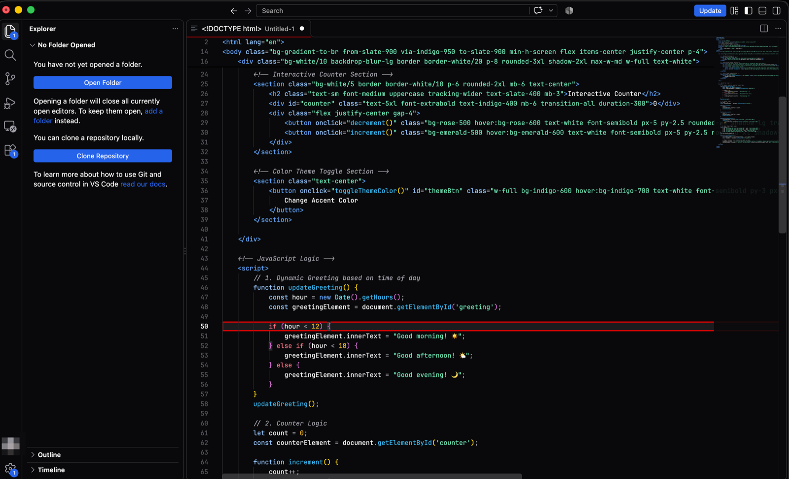
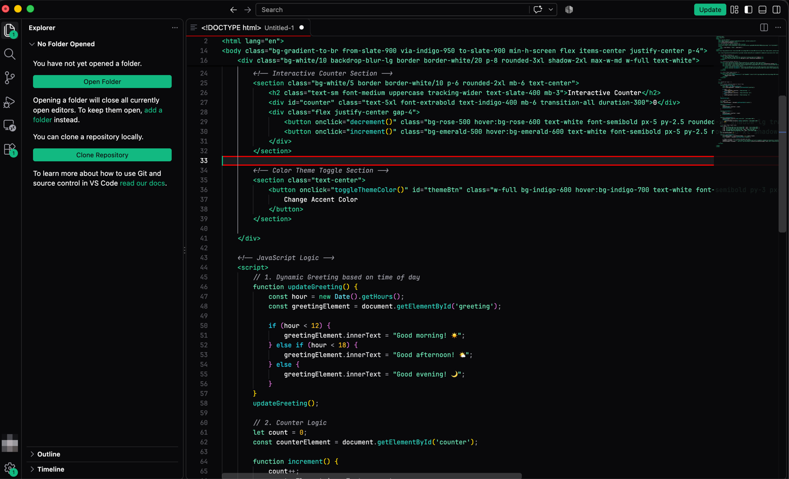
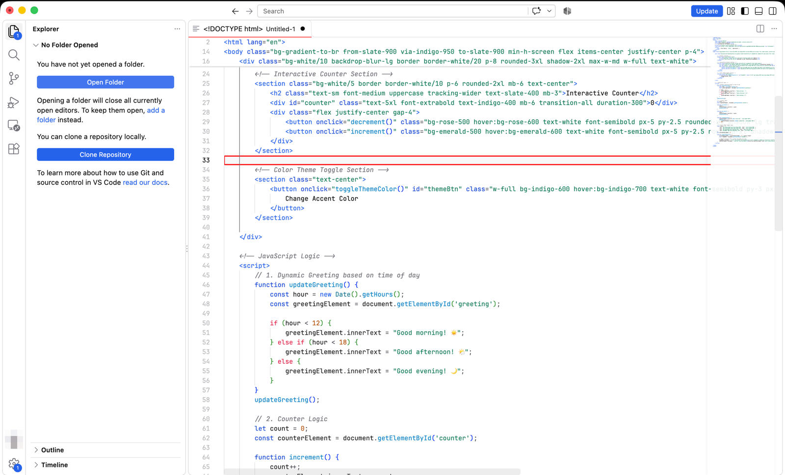
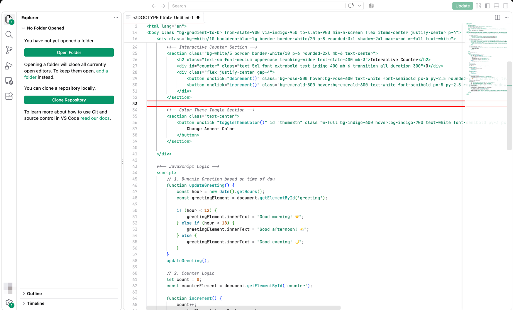
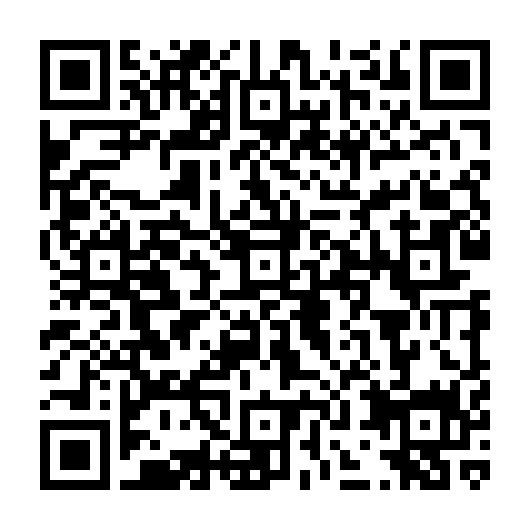

<p align="center">
  
</p>

<h1 align="center">ShadowVsCode Theme</h1>

<p align="center">
  <b>Shadcn/ui no VS Code.</b><br>
  Temas minimalistas, com superfícies discretas, bordas finas e contraste calibrado.
</p>

---

## Capturas de tela

| | |
|:-:|:-:|
|  |  |
|  |  |

## Instalação

Este repositório distribui a extensão. O código-fonte não é publicado aqui.

### VS Code Marketplace (VS Code, Cursor, Windsurf)
Em breve, pela aba de extensões, procurando por **ShadowVsCode Theme**.
Enquanto isso, use a instalação manual abaixo.

### Open VSX (VSCodium, Antigravity e outros forks)
Em breve, pela aba de extensões, procurando por **ShadowVsCode Theme**.

### Instalação manual (`.vsix`)
1. Baixe `shadow-vscode-theme-1.0.3.vsix` em [Releases](../../releases/latest).
2. No VS Code, abra o painel de extensões, clique em `...` e escolha **Install from VSIX...**.
   Ou pelo terminal:
   ```sh
   code --install-extension shadow-vscode-theme-1.0.3.vsix
   ```
   No Cursor ou no Windsurf, use `cursor` ou `windsurf` no lugar de `code`.

### Ativar o tema
Abra a paleta de comandos (`Ctrl+K Ctrl+T` ou `Cmd+K Cmd+T`) e escolha **ShadowVsCode**.

## Variantes

16 combinações, todas com versões claras e escuras:

| Base     | Cores de destaque |
| -------- | ----------------- |
| Zinc     | Blue, Emerald, Orange, Rose, Violet |
| Slate    | Blue, Emerald, Orange, Rose, Violet |
| Stone    | Blue, Emerald, Orange, Rose, Violet |

## Fontes recomendadas

Para melhor leitura do código, o tema combina com:
- **JetBrains Mono**
- **Fira Code** (com ligaduras)
- **Cascadia Code**

## Publisher

- **Publisher:** `95wesley`
- **Publisher page:** https://marketplace.visualstudio.com/publishers/95wesley *(active after creation)*
- **Website:** https://bywesley.com.br
- **Support:** [open an issue](../../issues)
- **GitHub profile:** https://github.com/95wesley

## Apoie o projeto

Se você usa o ShadowVsCode Theme, pode apoiar o trabalho:

- **Pix** (chave, e-mail): `we95sz@gmail.com`

<p align="center"></p>

Pix copia e cola:
```
00020101021226660014br.gov.bcb.pix0116we95sz@gmail.com0224Apoio ShadowVsCode Theme52040000530398654045.005802BR590895WESLEY6006BRASIL62070503***6304A8AF
```
- **Ko-fi:** [ko-fi.com/95wesley](https://ko-fi.com/95wesley)

## Licença

MIT. Veja [LICENSE](LICENSE).

© 2026 [95wesley](https://github.com/95wesley)
